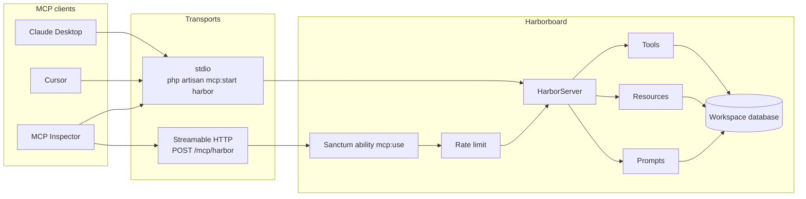

# Harborboard

The [Model Context Protocol](https://modelcontextprotocol.io) lets an AI client call tools, read resources, and fetch prompts from a server you control. Harborboard is a Laravel app that exposes a real classifieds CRM — listings, leads, and orders — through that protocol.

It is a portfolio piece for MCP, AI integration, and SaaS work: a small domain with authorization, two transports, and tests, rather than a single hard-coded tool.

## Package choice

This app uses [laravel/mcp](https://packagist.org/packages/laravel/mcp) **1.2.1** (constraint `^1.2`), the official Laravel package. It is stable, it requires Laravel `12.41.1` or `13`, and the [framework docs](https://laravel.com/docs/12.x/mcp) describe its tools, resources, prompts, stdio server, and streamable HTTP server. The app itself is Laravel **12.73** on PHP **8.3+** (developed and tested on 8.4).

[mcp/sdk](https://github.com/modelcontextprotocol/php-sdk) is the official framework-agnostic PHP SDK. It is still marked experimental before 1.0, so it is a better fit outside Laravel. `php-mcp/server` is unmaintained. Laravel MCP is the right dependency for this codebase.

HTTP authentication uses [Laravel Sanctum](https://laravel.com/docs/12.x/sanctum) personal access tokens. Laravel's MCP guide recommends Sanctum when the application does not already run Passport, and recommends Passport when a client can only authenticate with OAuth 2.1. Passport, including the discovery routes Laravel MCP registers, is listed on the roadmap below.

## Architecture



`routes/ai.php` registers one server twice:

- `Mcp::local('harbor', HarborServer::class)` starts as `php artisan mcp:start harbor` for Claude Desktop, Cursor, and MCP Inspector.
- `Mcp::web('/mcp/harbor', HarborServer::class)` is the streamable HTTP endpoint. It requires `auth:sanctum`, a token ability of `mcp:use` (or `*`), and the `mcp` rate limiter (60 requests per minute by default).

The stdio process has no HTTP user. It acts as `HARBOR_LOCAL_USER` (the seeded owner). That fallback is refused for web requests and for the test suite.

## What the domain contains

Northline Studio is a seeded workspace that sells furniture and lighting. Members share one workspace and have a role:

| Role | Read | Create and update leads, place orders | Archive listings |
| --- | --- | --- | --- |
| Viewer | Yes | No | No |
| Agent | Yes | Yes | No |
| Owner | Yes | Yes | Yes |

Write tools that a role cannot use are omitted from `tools/list`, so the model is not invited to call them. Policies still run inside the handler.

Seeded people (local fixtures, password `password`):

| Email | Name | Role |
| --- | --- | --- |
| `owner@harborboard.test` | Avery Chen | owner |
| `agent@harborboard.test` | Jordan Hale | agent |
| `viewer@harborboard.test` | Sam Okonkwo | viewer |

Seeded catalog:

| Slug | Status | Price |
| --- | --- | --- |
| `oak-writing-desk` | published | 840.00 USD |
| `linen-lounge-chair` | published | 620.00 USD |
| `brass-arc-lamp` | published | 310.00 USD |
| `walnut-media-console` | draft | 1290.00 USD |
| `ceramic-table-lamps` | sold | 180.00 USD |
| `marble-side-table` | archived | 450.00 USD |

Maya Ellis is a qualified lead on the oak desk. Chris Patel is a new lead on the lounge chair. Priya Shah already has fulfilled order `HB-1-0001`.

## Tools

Prices in arguments are major currency units (`700` means 700.00). Prices in results are decimal strings with a currency code.

| Tool | Access | What it does |
| --- | --- | --- |
| `search-listings` | read | Text, status, category, price range, sort, paging |
| `get-listing` | read | One listing by id or slug, with lead counts |
| `search-leads` | read | Text, status, listing, assignee |
| `get-lead` | read | One lead plus its activity history |
| `pipeline-summary` | read | Counts, money by order status, leads that need attention |
| `search-orders` | read | Orders, optionally by status |
| `create-lead` | agent, owner | Validates and writes immediately. An `idempotency_key` returns the original lead on retry |
| `update-lead-status` | agent, owner | Moves `new`, `contacted`, `qualified`, and `lost`. Repeating the same status is a no-op. `converted` is rejected |
| `place-order` | agent, owner | Preview unless `confirm` is `true`. A confirmed call creates the order, converts the lead, and marks the listing sold |
| `archive-listing` | owner | Preview unless `confirm` is `true`. The preview includes open leads. Archiving twice is safe |

`place-order` and `archive-listing` are the confirmation gate. The first call, with `confirm` omitted or `false`, returns `requires_confirmation: true` and writes nothing. A second call with `confirm: true` commits. A model that guesses an order still has to pass that flag, and the host should show the preview to a person before it does.

## Resources and prompts

| Kind | Name | URI or arguments |
| --- | --- | --- |
| Resource | `workspace-overview` | `harbor://workspace/overview` |
| Resource | `qualification-playbook` | `harbor://playbook/qualification` |
| Resource template | `listing` | `harbor://listings/{listing}` |
| Resource template | `lead` | `harbor://leads/{lead}` |
| Prompt | `qualify-lead` | `lead_id`, optional `tone` (`direct`, `warm`, `concise`) |
| Prompt | `draft-follow-up` | `lead_id`, optional `channel` (`email`, `sms`) |
| Prompt | `weekly-pipeline-review` | optional `focus` (`listings`, `leads`, `orders`, `all`) |

Prompts embed the current database row. They do not send email or change statuses.

## Quick start

Requirements: PHP 8.3 or 8.4 with `mbstring`, `xml`, `curl`, `sqlite`, `zip`, `bcmath`, and `intl`, plus Composer. Node is only required for MCP Inspector. The home page does not need a frontend build.

`composer.json` pins the Composer platform to PHP 8.3.27, so `composer update` keeps a lock file that installs on both 8.3 and 8.4. Symfony 8 requires PHP 8.4, and this app stays on the Symfony 7 line Laravel 12 also accepts.

```bash
git clone https://github.com/ali-dev5490/laravel_mcp.git
cd laravel_mcp
composer setup
php artisan serve
```

`composer setup` installs dependencies, copies `.env.example` to `.env`, generates `APP_KEY`, creates `database/database.sqlite`, and runs `php artisan migrate --force --seed`.

The same steps by hand:

```bash
composer install
cp .env.example .env
php artisan key:generate
touch database/database.sqlite
php artisan migrate --seed
php artisan serve
```

Open [http://127.0.0.1:8000](http://127.0.0.1:8000). After seeding, the page shows Northline Studio's listing, lead, and order counts.

SQLite is the default. Point `DB_*` at MySQL or Postgres if you want another engine; the migrations use the Laravel schema builder.

Issue an HTTP token (shown once):

```bash
php artisan harbor:token owner@harborboard.test
```

## Claude Desktop

Claude Desktop config lives at `~/Library/Application Support/Claude/claude_desktop_config.json` on macOS and `%APPDATA%\Claude\claude_desktop_config.json` on Windows. Use the absolute path to `artisan`:

```json
{
  "mcpServers": {
    "harborboard": {
      "command": "php",
      "args": [
        "/absolute/path/to/laravel_mcp/artisan",
        "mcp:start",
        "harbor"
      ]
    }
  }
}
```

Restart Claude Desktop. The server runs as `HARBOR_LOCAL_USER` from `.env`, which defaults to the seeded owner. Ask Claude to search published listings under $700.

## Cursor

This repository includes [`.cursor/mcp.json`](.cursor/mcp.json). Cursor starts the server with the project as the working directory:

```json
{
  "mcpServers": {
    "harborboard": {
      "command": "php",
      "args": ["artisan", "mcp:start", "harbor"]
    }
  }
}
```

For the HTTP transport, run `php artisan serve`, mint a token, and point Cursor at the URL:

```json
{
  "mcpServers": {
    "harborboard-http": {
      "url": "http://127.0.0.1:8000/mcp/harbor",
      "headers": {
        "Authorization": "Bearer YOUR_SANCTUM_TOKEN"
      }
    }
  }
}
```

## MCP Inspector

Stdio, which is the same command Claude and Cursor run:

```bash
php artisan mcp:inspector harbor
```

Or the Inspector CLI, which connects, lists or calls, and exits:

```bash
npx @modelcontextprotocol/inspector --cli php artisan mcp:start harbor --method tools/list
npx @modelcontextprotocol/inspector --cli php artisan mcp:start harbor \
  --method tools/call --tool-name search-listings \
  --tool-arg status=published --tool-arg max_price=700
```

HTTP, with the app already serving and a bearer token pasted into the Inspector's header field:

```bash
php artisan serve
php artisan mcp:inspector mcp/harbor
```

A verified stdio listing returns all ten tools. A verified call to `search-listings` with `status=published` and `max_price=700` returns the brass arc lamp (310.00) and the linen lounge chair (620.00), and leaves the oak desk out.

## Example conversation

**You:** Which published pieces are under $700, and who still needs a first reply?

The client calls `search-listings` and `search-leads`. It should name the brass arc lamp and the linen lounge chair, and it should name Chris Patel as a `new` lead. The oak desk is 840.00, so it stays out of the price filter. Maya Ellis is already qualified, so she is not waiting on a first reply.

**You:** Draft a short SMS to Chris about the lounge chair. Then preview an order for Maya's desk. Do not place it.

The client calls `draft-follow-up` with Chris's lead id and `channel=sms`, then `place-order` with Maya's lead id and `confirm` false. The preview looks like this and the database is unchanged:

```json
{
  "committed": false,
  "requires_confirmation": true,
  "message": "No order was written. Show this preview to the user, then call place-order again with confirm=true to commit it.",
  "preview": {
    "buyer": "Maya Ellis",
    "listing": "Oak writing desk",
    "amount": "840.00",
    "currency": "USD",
    "resulting_lead_status": "converted",
    "resulting_listing_status": "sold"
  },
  "order": null
}
```

**You:** Place it.

Only then should the client call `place-order` with `confirm` true. The lead becomes `converted`, the listing becomes `sold`, and a second confirmed call is rejected because the order already exists.

**You:** Read the qualification playbook and tell me whether Elena Rossi is ready to buy the brass lamp.

The client reads `harbor://playbook/qualification` and `get-lead`. Elena is `contacted`, which is not `qualified`, so the answer should be to ask the remaining question rather than to preview an order.

## Security

- Every query is filtered by the signed-in member's `workspace_id`. A miss is reported as not in the caller's workspace, so another tenant's ids are not confirmed.
- Viewers do not receive write tools. Agents do not receive `archive-listing`. Policies repeat those checks inside the handlers.
- `place-order` and `archive-listing` write only when `confirm` is true. Show that preview to a person. The flag is a server-side gate, and a careful host still asks the user before setting it.
- `create-lead` accepts an `idempotency_key`. The same key returns the original lead and ignores the second payload.
- HTTP tokens need the `mcp:use` ability. `php artisan harbor:token` prints the plain token once; Sanctum stores only its hash.
- The `mcp` limiter allows `HARBOR_MCP_RATE_LIMIT` requests per minute (default 60), keyed by user id.
- Laravel MCP checks the `Origin` header on web requests and rejects origins other than the app URL and localhost.
- The stdio server trusts the operating-system user and acts as `HARBOR_LOCAL_USER`. Bind that address to a real member, and keep `mcp:start` on the machine that owns the data.
- The seeded password is a local fixture. Change it, or skip the seeder, before any shared deployment. `.env.example` contains no credentials beyond that published demo password.

## Tests and CI

[Pest](https://pestphp.com) covers the tool catalog by role, search scoping, validation, idempotency, the lead state machine, order preview versus commit, resources, prompts, Sanctum, the token ability, rate limiting, and the token command. [Pint](https://laravel.com/docs/12.x/pint) and [Larastan](https://github.com/larastan/larastan) (PHPStan level 6) run locally and in CI.

```bash
vendor/bin/pint
vendor/bin/phpstan analyse
php artisan test
```

GitHub Actions (`.github/workflows/ci.yml`) runs those three on PHP 8.3 and 8.4 for every push and pull request.

## Docker

Docker is optional. SQLite and `composer setup` are enough for local use.

```bash
docker compose up --build
```

The container listens on port 8000, installs Composer dependencies when `vendor/` is missing, generates `APP_KEY` when it is empty, and migrates and seeds. Re-running the seeder is a no-op once the `northline` workspace exists. Reset with `php artisan migrate:fresh --seed`.

## Project layout

```
app/Mcp/Servers/HarborServer.php      Server name, instructions, registration
app/Mcp/Tools                         Ten tools
app/Mcp/Resources                     Static resources and URI templates
app/Mcp/Prompts                       Qualify, follow-up, weekly review
app/Domain                            Status machine, orders, pipeline
app/Policies                          Workspace and role checks
routes/ai.php                         stdio handle and HTTP route
config/harbor.php                     Local user, demo accounts, rate limit
```

## Roadmap

- OAuth 2.1 with Laravel Passport and `Mcp::oauthRoutes()`, for clients that cannot hold a token you mint yourself
- Cancel and refund an order without leaving the listing sold
- A Livewire desk on top of the same models, so the workspace is usable without an MCP client
- Listing photos as blob resources
- A signed webhook when an order is placed

## License

MIT. See [LICENSE](LICENSE).

## Hire me

Built as a portfolio piece by a senior Laravel engineer (9+ years) who ships Laravel, Vue, and Livewire products and wires them to OpenAI and MCP clients.

- Name: [Your name]
- Upwork: [Your Upwork profile URL]
- Email: [you@example.com]
- GitHub: [your GitHub URL]
